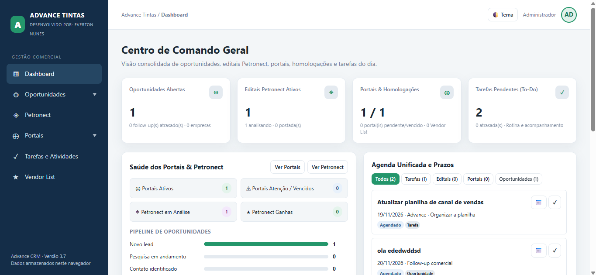

# 🎨 Advance CRM — Sistema de Gestão Comercial, Licitações & Portais B2B

Desenvolvido por **Everton Nunes** para otimizar a operação comercial, prospecção industrial e gestão de editais e portais de compras da **Advance Tintas**.

**Link:** https://evertonnunesc.github.io/advance-crm/

##  💻 Layout

## 🎯 O Problema Resolvido

Na rotina comercial B2B e de vendas para indústrias, construtoras e órgãos públicos, as informações costumam ficar fragmentadas entre planilhas soltas, anotações de prazos de licitação, credenciais de dezenas de portais de compras e controles de homologação (*Vendor List*).

O **Advance CRM** centraliza todo o ciclo comercial em uma única interface rápida, responsiva, com suporte a **Modo Claro/Escuro** e funcionamento **100% offline/local** (sem dependência de servidores externos ou mensalidades).

---

## 🚀 Principais Funcionalidades

### 1. Centro de Comando Geral (Dashboard)
* **KPIs em tempo real:** Oportunidades abertas, follow-ups atrasados, editais Petronect ativos, saúde dos portais e tarefas pendentes.
* **Agenda Unificada com Filtros:** Consolida prazos de oportunidades, vencimentos de editais, validade de cadastros em portais e tarefas do dia, com exportação direta de compromissos para o **Microsoft Outlook (`.ics`)**.
* **Funil Comercial:** Visualização gráfica do pipeline por etapa de negociação.

### 2. Pipeline de Oportunidades, Empresas & Contatos
* Cadastro completo de contas (com máscara automática de CNPJ/telefone e autopreenchimento de dados da empresa).
* Gestão de múltiplos contatos e múltiplos itens/produtos por oportunidade, com cálculo automático do valor total da proposta.
* Controle de status comercial e checklist de conclusão.

### 3. Módulo Especializado Petronect
* **Dupla Visualização:** Alternância instantânea entre **Tabela** e **Quadro Kanban** com *Drag & Drop* (arrastar e soltar) entre etapas (*Analisando, Sala de Colaboração, Postada, Ganha, Perdida, Declinada*).
* **Calculadora de Precificação Técnica:** Cálculo automático de conversão de volume (Litros/Galões), aplicação de fator de ICMS, descontos comerciais, preço por litro e margem de lucro em tempo real.
* **Geração de Proposta em PDF:** Impressão formatada da proposta comercial diretamente pelo navegador.
* Cálculo automático do trimestre (`Q1` a `Q4`) pela data de encerramento.

### 4. Gestão de Portais & Homologação (*Vendor List*)
* **Painel Analítico:** Gráfico de rosca (*Donut Chart*) e barras de distribuição por status (*Ativo, Pendente, Em cadastro, Bloqueado, Atualização necessária, Vencido*).
* **Cofre de Credenciais:** Armazenamento de URLs, logins e senhas de portais de compras com botões de cópia rápida para a área de transferência.
* **Histórico Auditável:** Registro cronológico de alterações cadastrais, trocas de senha, bloqueios e renovações.
* **Acompanhamento de Vendor List:** Controle dedicado de etapas de homologação de fornecedores.

### 5. Tarefas e Rotina Comercial (To-Do)
* Gerenciamento de pendências internas e follow-ups vinculados a clientes, com alertas de prazo vencido.

### 6. Segurança, Controle de Acesso & Backup
* **Autenticação Multi-usuário:** Perfis separados para **Administrador** e **Usuário Comercial**, com geração automática de senha inicial e troca obrigatória no primeiro acesso.
* **Trava de Segurança:** Exclusões de registros e restaurações de base exigem autenticação do Administrador.
* **Portabilidade Total de Dados:**
  * Exportação e restauração completa via **JSON**.
  * Exportação individual em **CSV** ou pacote completo compactado em **`.ZIP` nativo** (gerado via código puro em JavaScript, sem bibliotecas externas) contendo todas as bases separadas.

---

## 🛠️ Arquitetura e Diferenciais Técnicos

* **Zero Dependências Externas:** Construído inteiramente com **HTML5, CSS3 (Custom Properties / Grid / Flexbox) e JavaScript Vanilla (ES6+)** em arquitetura *Single-File Application*.
* **Geração Binária Nativa:** Implementação própria de empacotamento **ZIP (CRC32 + Headers binários)** e geração de eventos **iCalendar (`.ics`)** no lado do cliente.
* **Persistência e Performance:** Armazenamento estruturado em `localStorage` com IDs sequenciais inteligentes por módulo e período (ex: `OP1120260001`, `PN1120260001`).
* **UI/UX Adaptável:** Suporte nativo a **Dark Mode** e **Light Mode**, avatares personalizados com recorte automático via HTML5 Canvas e layout responsivo.

tãoComercial` `#B2B` `#Petronect` `#Inovação` `#Produtividade`
